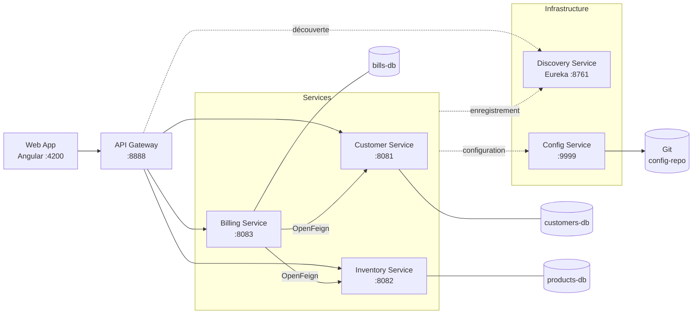
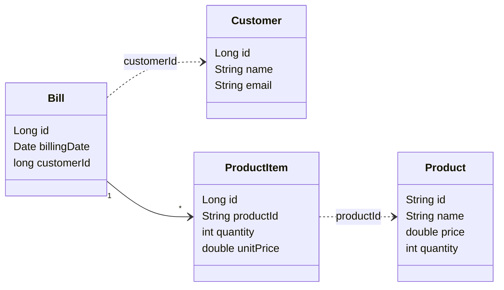
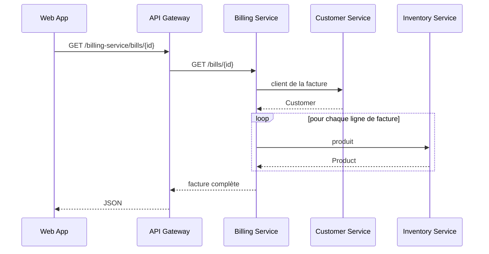
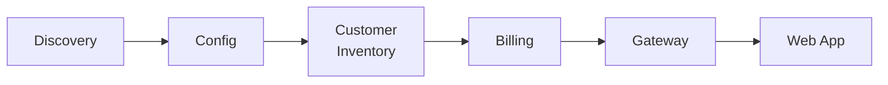

# Ecom Micro-services


Plateforme de facturation construite sur une **architecture micro-services**. Elle gère des **clients**, un **catalogue de produits** et des **factures**, et propose une interface web en **Angular**.

Chaque domaine métier est un service indépendant, avec sa propre base de données. Les services se découvrent dynamiquement, partagent une configuration centralisée et sont exposés derrière une passerelle unique.

---

## Architecture



| Service | Port | Responsabilité |
|---|---|---|
| **API Gateway** | 8888 | Point d'entrée unique, routage dynamique vers les services, CORS |
| **Discovery Service** | 8761 | Annuaire des services (Eureka) |
| **Config Service** | 9999 | Configuration centralisée, stockée dans le dossier `config-repo` du dépôt Git |
| **Customer Service** | 8081 | Gestion des clients |
| **Inventory Service** | 8082 | Gestion du catalogue de produits |
| **Billing Service** | 8083 | Gestion des factures, agrège les données clients et produits |
| **Web App** | 4200 | Interface utilisateur |

---

## Stack technique

- **Backend** : Java 25, Spring Boot 4, Spring Data JPA, Spring Data REST, Spring HATEOAS, Lombok
- **Micro-services** : Spring Cloud Gateway, Netflix Eureka, Spring Cloud Config, OpenFeign, Spring Cloud LoadBalancer
- **Base de données** : H2 (en mémoire)
- **Frontend** : Angular 22, Bootstrap 5
- **Build** : Maven, npm

---

## Modèle de données



Le Billing Service ne stocke que les **identifiants** des clients et des produits. Lorsqu'on consulte une facture, il récupère les données complètes auprès des autres services, via OpenFeign.



---

## API

Les routes de la Gateway sont générées automatiquement à partir des services enregistrés dans Eureka. Elles suivent le format `http://localhost:8888/{nom-du-service}/...`.

| Méthode | Endpoint (via la Gateway) | Description |
|---|---|---|
| GET | `/customer-service/api/customers` | Liste des clients (paginée) |
| GET | `/customer-service/api/customers/{id}` | Détail d'un client |
| GET | `/inventory-service/api/products` | Liste des produits (paginée) |
| GET | `/inventory-service/api/products/{id}` | Détail d'un produit |
| GET | `/billing-service/api/bills` | Liste des factures |
| GET | `/billing-service/bills/{id}` | Facture complète, avec le client et les produits |

Les dépôts Spring Data REST exposent aussi les opérations `POST`, `PUT`, `PATCH` et `DELETE`.

Le Customer Service propose en plus deux projections :
- `?projection=all` renvoie le nom et l'email ;
- `?projection=email` renvoie l'email seul.

---

## Configuration

Chaque service ne contient en local que son nom, son port et l'adresse du Config Service. Le reste de la configuration se trouve dans le dossier [`config-repo/`](config-repo) :

| Fichier | Portée |
|---|---|
| `application.properties` | Configuration commune à tous les services |
| `{service}.properties` | Configuration propre à un service |
| `{service}-dev.properties` / `{service}-prod.properties` | Surcharges par environnement |

Les changements peuvent être appliqués **à chaud**, sans redémarrage. Il suffit de les pousser sur le dépôt, puis d'appeler `POST /actuator/refresh` sur le service concerné.

---

## Démarrage

### Prérequis

- JDK 25
- Maven 3.9+
- Node.js 22.22.3+ ou 24.15+

### Lancement

Les services doivent être démarrés dans l'ordre suivant :



```bash
# Dans chaque dossier de service, dans l'ordre ci-dessus
mvn spring-boot:run

# Interface web
cd ecom-web-app
npm install
npm start
```

L'application est alors disponible sur **http://localhost:4200**, et le tableau de bord Eureka sur **http://localhost:8761**.

> Le Billing Service interroge le Customer Service et l'Inventory Service dès son démarrage. Il faut attendre qu'ils apparaissent comme **UP** dans Eureka avant de le lancer.

---

## Structure du projet

```text
.
├── config-repo/          # Configuration centralisée
├── discovery-service/    # Eureka Server
├── config-service/       # Config Server
├── gateway-service/      # API Gateway
├── customer-service/     # Clients
├── inventory-service/    # Produits
├── billing-service/      # Factures
└── ecom-web-app/         # Interface Angular
```

---

## Auteur

**Ilyass Hakim** · [GitHub](https://github.com/Ilyass-Hakim)
